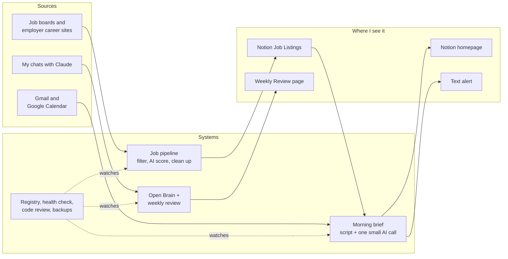

# What I've built and kept running with Claude

**Patricia Filipovic** · March to October 2026 · [craftingmetrics.com](https://craftingmetrics.com) · [Interactive version](https://bkindtoall.github.io/working-with-claude/)

Since March 2026 I've been building personal systems with Claude that run my job search, my mornings and my email. I've become quite comfortable working with AI and maintaining the agents and automations I build, mostly with Claude (Chat, Code, and Cowork) and ChatGPT (Chat and Codex), including connecting them through APIs to other software like Notion.

Claude Code wrote the code at my direction. My part has been deciding what each system should do and catching it when it went wrong. The part I enjoy most is keeping it all in order, knowing what each tool is for and whether it's still worth what it costs.

This repository is the record of that work, including the routines that were improved, replaced or retired along the way.

The code and data stay private because they hold my career and household records, so this repo describes the work instead of publishing it.

| | |
|---|---|
| **14** | scheduled jobs tracked in one registry with a weekly health check |
| **3,387** | notes in Open Brain, my personal knowledge base |
| **460K → 7K** | tokens per morning brief after the rebuild |
| **~$151 → ~$50** | monthly cost of AI job scoring, on the same model |

## AI tool operations

These are personal systems with one user, so the scale is small. The upkeep they need is the same kind a team's AI tools need, and I've been doing it every week since July.

- **Inventory.** One registry lists every automation with its purpose, schedule, model, logs and whether it should be running. A weekly check compares the list with what's actually scheduled, and anything running that isn't listed gets flagged. That check found a job that had failed for 9 straight weeks. Each job names its own model, so nothing quietly runs on a stale default.
- **Use cases and needs.** Every new automation starts with the need it serves and a comparison of a plain script against each model size on cost and value. When I reviewed 12 niche job boards, two met the need and were adopted, and the other ten are on record with the reason each was skipped. Retired tools keep a note on why they went, so nobody rebuilds them by accident.
- **Adoption and usage.** Every AI job logs its tokens on each run, and the weekly check reports usage by job. Usage numbers showed a nightly sync spending 690,000 tokens to save about one note. An adoption audit showed my writing corrections almost never reached the knowledge base, so I moved the capture to the moment I make them.
- **Access.** Each job gets the least access it needs. The brief and the alerts read Gmail through a read-only token, and only the cleanup job holds write access, on its own token. Keys live in the macOS Keychain. I trimmed two permission lists that had grown to 242 and 24 one-off approvals, so each unattended task now has one exact permission.
- **Clean data.** Status names live in one file every script reads. Stable IDs stopped duplicate listings, 25 missing application dates were backfilled and marked as estimates, and my labels are saved before any row is archived. Outdated notes get marked superseded so search stops surfacing them, and the nightly backup refuses to overwrite itself with a smaller copy.

## How it fits together

## How I work

Each of these started as a specific problem. They're now the rules every new automation has to follow.

- **Scripts first.** Plain scripts handle fetching, sorting and date math. AI only gets the parts that need judgment, and the smallest model that does the job well.
- **Measure every run.** Every job that uses AI records its tokens on each run. Before I build anything new, I compare a plain script with each model size on cost and value.
- **Nothing disappears quietly.** Filtered jobs go to a log, my labels are saved before anything is archived, and the health check reads every error log.
- **The record says what I said.** My career record holds only facts I've confirmed in my own words. Anything Claude inferred waits for me.
- **Settled stays settled.** Once I decide something, it's recorded as final. New evidence gets raised once as a question, and nothing changes until I answer.
- **Private stays local.** My records are versioned in local git with no remote. Alert texts carry a category and a count, never who sent the email.

## The work, by area

### Memory and home base
*Open Brain (3,387 notes) and a Notion homepage*

- **Mar 22 · Started · Open Brain.** I set up a personal knowledge system from a published build guide, using Supabase, vector search and MCP so any AI tool I use can read from it and write to it. Then I imported 2,091 of my ChatGPT conversations going back to 2023.
- **Mar 27 · Started · Notion Command Center.** Notion became the place I track my day, with archiving rules so the page only shows what's current.
- **Apr 20 · Improved · Open Brain connected everywhere.** I deployed its connector as a Supabase Edge Function so every Claude session could use it, and settled the split I still use. Notion is where I track things, and Open Brain is where knowledge lives. Later I moved the access key out of the connection URL and into a request header.

### Morning brief
*Daily 7:00am, about 7,000 tokens a run*

- **Mar 23 · Started · Morning Window recap.** My first scheduled Claude routine, summarizing yesterday into Notion every morning at 8.
- **Sep 15 · Replaced · Morning brief rebuilt.** A script gathers my calendar, email, commitments and job check-ins, and one small Haiku call writes the summary. Commitments I make in a Claude chat show up as to-dos the next morning. *(~460K → ~7K tokens a run)*
- **Sep 23 · Improved · One place to track applications.** The brief notes when an employer confirmed my application and when I last heard from them, and prompts a check-in at 14 days, or 28 for public sector roles.
- **Oct 2 · Improved · Checkboxes.** Emails waiting on me and open questions are tickable. A ticked email stays hidden until a new message arrives, and a ticked question isn't asked again.
- **Oct 5 · Improved · Email updates application status.** The brief reads new mail from employers I've applied to and updates the status in Notion. The first test run found 7 real rejections and no false ones.

### Email
*Sorted inside the 7am brief; Gmail cleanup Mondays 3:00am*

- **Mar 30 · Started · Four email digests a day** at 8, 11, 1 and 4, sorted by rules we wrote together.
- **May 5 · Retired · The digests stop.** They hit my usage limit and had grown my Notion page to about 50KB. When I traced it later, every slot had been scheduled twice. *(~3–5M tokens a day)*
- **May 28 · Started · Weekly Gmail cleanup**, a plain Python script with no AI.
- **Sep 17 · Replaced · Email sorted by rules inside the brief.** No extra AI call. A separate alert texts me when an employer needs an answer or a bill has a problem, with only a category and a count.
- **Sep 17 · Improved · Least access for each job.** The brief and the alerts share a read-only Gmail token that neither one rewrites. The cleanup job deletes mail, so it keeps write access on a separate token of its own.
- **Sep 17 · Fixed · Cleanup was deleting interview invites.** It trashed mail from Greenhouse, Lever, Workday and other applicant tracking systems after 7 days. Those now archive after 30.

### Job search pipeline
*Scrape daily 6:00am; cleanup 8:45am; target sweep Sundays 7:00pm*

- **Apr 23 · Started · Daily GRC job digest**, a Claude routine searching the web each morning. *(~1.7M tokens a run)*
- **Jun 2 · Started · Job board scraper** in Python, posting new listings to a Notion database every morning.
- **Jul 15 · Improved · A New checkbox for fast triage**, kept separate from application status. Anything I never looked at is archived after 7 days.
- **Jul 26 · Improved · AI scoring against my own profile.** Claude scores each posting against a written profile built from my notes, which I corrected before it went live.
- **Aug 20 · Improved · My own staging buckets.** Statuses I name after tiers and groups are recognized by name. Jobs I've applied to are never archived automatically, because they're the examples the scoring is checked against.
- **Sep 2 · Started · Career fair employer sweep.** Before the JBLM veteran hiring fair, we swept the fair's employer list across government job sites and company career pages so I knew which booths had something for me. Every match is checked against the platform's own company name, because guessed names collided often.
- **Sep 4 · Improved · Scoring bill cut by about two-thirds.** $22 auto-reload invoices every few days added up to about $151 a month against a $44 budget. A free prefilter plus batch processing with prompt caching brought the first week to $1.41 a run. Batch and live scoring agreed on 236 of 237 jobs. I kept the strongest model, since a wrongly rejected job is invisible to me.
- **Sep 10 · Fixed · A filter that dropped a job I'd applied to.** The first seniority filter would have dropped one of my applications, so every change is tested until it drops none of my 34 applied rows. Filtered jobs still go to a log.
- **Sep 14 · Replaced · Niche boards join the main pipeline.** Of the old digest's 12 niche boards, two had proper public feeds and were added. The other ten are recorded with the reason each was skipped.
- **Sep 15 · Fixed · Backfilled missing application dates.** 25 Applied rows had no date, which broke check-in timing. They were filled with marked estimates, and new Applied rows get a date automatically.
- **Sep 15 · Improved · Teaching the scorer from my no's.** I mark a poor match "Does Not Meet" with one line about why, and those reasons are saved before any row is archived.
- **Oct 5 · Replaced · One cleanup pass a day.** Two archivers ran on different rules, and one archived a labelled rejection before my reason was saved. One daily pass now learns from roles I mark Not Related, saves my labels and logs every archived row.
- **Oct 5 · Started · Target employer sweep** of an employer list I keep in Notion, scored the same way as everything else.

### Writing in my voice
*Weekly review Sundays 11:30am; Claude and ChatGPT drafting by hand*

- **Aug 2 · Started · /consensus drafting loop.** I built a loop where Claude drafts and ChatGPT critiques through the API. It worked, though every API call starts fresh, so I lost the persona ChatGPT and I have built up over time. Since then I copy drafts between the two by hand, because together they find my voice better than either does alone. Rejected suggestions are still logged with their reasons, and a story library holds the strongest claim each part of my career can honestly support. Next up is a shared MCP connection so the two can talk to each other directly.
- **Sep 14 · Started · Weekly review of my corrections.** Facts I'd settled in one résumé chat kept getting re-asked in the next. A weekly job folds my corrections into one verified record and posts anything needing my approval to Notion.
- **Sep 14 · Fixed · Audit of what reached the knowledge base.** Career facts were arriving well, yet only 1 of 40 notes captured how I want things worded, and /consensus's save step called a tool name that didn't exist. Corrections are now saved at the moment I make them.
- **Sep 20 · Fixed · The record only says what I said.** Some entries marked verified were really Claude's inferences, and two were wrong. Records now carry only my own words.
- **Sep 21 · Improved · Settled decisions stay settled.** After one résumé detail flipped four times, decisions are recorded as final and Claude asks once before reopening anything.
- **Sep 24 · Fixed · Newer corrections win** over the weekly record, so a Tuesday correction doesn't lose to Monday's rebuild.

### Keeping it all running
*Health check Sundays 10:00am; code review Sundays 10:30am; backup nightly 11:15pm*

- **Jun 10 · Fixed · "Operation not permitted."** Jobs ran by hand and failed on schedule because macOS privacy protection blocks background jobs from the Documents folder. We moved every project out. A few older routines stopped in the move unnoticed, which is part of why the health check exists.
- **Jul 15 · Started · Automations registry and health check**, after a Gmail cron job failed silently for weeks because it called the wrong copy of Python.
- **Sep 14 · Started · A rule for every AI job.** Each one justifies its schedule and model and records token use on every run.
- **Sep 14 · Improved · Permission lists trimmed.** Two lists had grown to 242 and 24 one-off approvals. Each unattended task now has one exact permission for the one script it runs.
- **Sep 14 · Improved · A model named for every job.** A global default had gone stale. Each automation names its own model, and interactive work uses the best current one.
- **Sep 14 · Fixed · Health check said "succeeded" while stuck** on a permission prompt for three weeks. Unattended tasks now run one script with one exact permission.
- **Sep 17 · Fixed · A duplicate job that never once worked** for 9 Mondays. The drift check now inspects every scheduled job whatever its name.
- **Sep 27 · Started · Version history and nightly backups.** Every store is a local git repository, and a nightly job exports Open Brain and commits changes. The export refuses to overwrite the backup if it comes back empty or much smaller.
- **Oct 2 · Started · Weekly AI code review.** My rotation design has Sonnet review one changed automation a week. The first full pass found 60 issues and we fixed 10 that day. Medium effort missed a known bug and high effort ranked it first, so it runs at high.

### Household and side projects

- **Apr 20 → Sep 17 · Replaced · Nightly Notion sync.** The original used about 690,000 tokens a run to save roughly one note. The rebuild checks for changes for free first. Paused while I decide whether I still need it.
- **Jun 8 → Sep 14 · Replaced · Monthly bills reset.** About a million tokens a run to untick checkboxes, now a small script with no AI.
- **Sep 30 · Started · Tabscape**, a Chrome extension that groups open tabs into boxes on the new tab page. Plain JavaScript, no AI, no server, with a test that fails if its permissions drift.

## Inventory

My registry as of October 2026, in plain language. Usage comes from the per-run token logs.

| Tool | Schedule | Use case | AI used | Access it holds | Usage | State |
|---|---|---|---|---|---|---|
| Job scraper and scoring | Daily 6:00am | Find new roles and score them against my profile | Opus 5, batch | Public job boards, Notion Job Listings, API key in Keychain | ~$1.41–2.25/run | Active |
| Daily job cleanup | Daily 8:45am | Learn from my rejections, save labels, archive dead rows | None | Notion Job Listings | 0 tokens | Active |
| Target employer sweep | Sundays 7:00pm | Check employers on my list for new roles | Opus 5, batch | Public career feeds, Notion | ≤25 jobs, ~2¢ each | Active |
| Morning brief | Daily 7:00am | One page with my day, email that needs me and application status | Haiku 4.5, one call | Gmail read-only, Calendar, Notion homepage and to-dos, Open Brain | ~7K tokens/run | Active |
| Email alerts | Every 15 min, 7am–9pm | Text me when an employer or a bill needs me | None | Gmail read-only (shared, never rewritten), Messages | 0 tokens | Awaiting first supervised run |
| Gmail cleanup | Mondays 3:00am | Clear promotions and old mail | None | Gmail with write access, on its own token | 0 tokens | Active |
| Weekly review | Sundays 11:30am | Fold my corrections into the verified career record | Sonnet | Open Brain, Notion review page, local records | ~350–450K tokens/run | Active |
| Review apply step | Daily 8:00pm | Apply the changes I approved | None | Notion review page, local records | 0 tokens | Active |
| Weekly code review | Sundays 10:30am | Find bugs in one changed automation a week | Sonnet 5.5, high effort | Local code, read only | ~25K tokens/unit | Active |
| Health check | Sundays 10:00am | Compare the registry with what's running, read error logs, report usage | Claude task, one script | One exact permission, Notion health log | logged weekly | Active |
| Nightly backup | Daily 11:15pm | Export Open Brain and commit every record store | None | Open Brain read, local git with no remote | 0 tokens | Active |
| Bills reset | 1st of the month | Untick last month's Paid boxes | None | One Notion page | 0 tokens | Active |
| Notion to Open Brain sync | Daily 11:10pm | Save notes from my homepage | Sonnet, only on change | Notion homepage, Open Brain, Calendar | 0 most nights | Paused |
| Interactive tools | On demand | Writing, building and reviewing | Claude Chat, Code and Cowork; ChatGPT Chat and Codex; Claude and ChatGPT review each other's drafts by copy and paste | Connectors to Open Brain, Notion, Gmail and Calendar | best current model | In use |

### Starting an inventory of your own

1. List every tool and scheduled job in one place, with its purpose and whether it should be running.
2. Write down what each one can access, and cut it to the least it needs.
3. Log usage on every run, so cost and adoption show up as numbers.
4. Compare the list with what's actually running each week. Anything unlisted is a finding.
5. When something is retired, record why, so it doesn't get rebuilt by accident.

## Replaced and retired

| Original | Ran | Why it went | Replaced by | Cost before → after |
|---|---|---|---|---|
| Four daily email digests | Mar–May | Usage limit; double-scheduled; Notion timeouts | Rules in the morning brief + text alerts | 3–5M/day → 0 extra |
| Morning Window recap | Mar–Jun | Lost in a folder move; mostly empty | Morning brief | 460K → 7K/run |
| Daily GRC job digest | Apr–May | Web search was costly and inconsistent | Scraper + two niche boards | 1.7M/run → scraper |
| Bills reset task | Jun | Needs no AI | Plain script | ~1M/run → 0 |
| Nightly Notion sync task | Apr–May | Spent heavily for about one note a night | Change-gated script (paused) | 690K/run → 0 most nights |
| Side-by-side scoring test | Sep 5–10 | Proved batch matches live, 236 of 237 | Switched off | ~$25/month → 0 |
| Two job archivers | Jul–Oct | One archived a row before my label was saved | One daily cleanup pass | no AI either way |
| Duplicate Gmail cleanup | 9 Mondays | Pointed at a folder, never ran | Removed; drift check rewritten | n/a |
